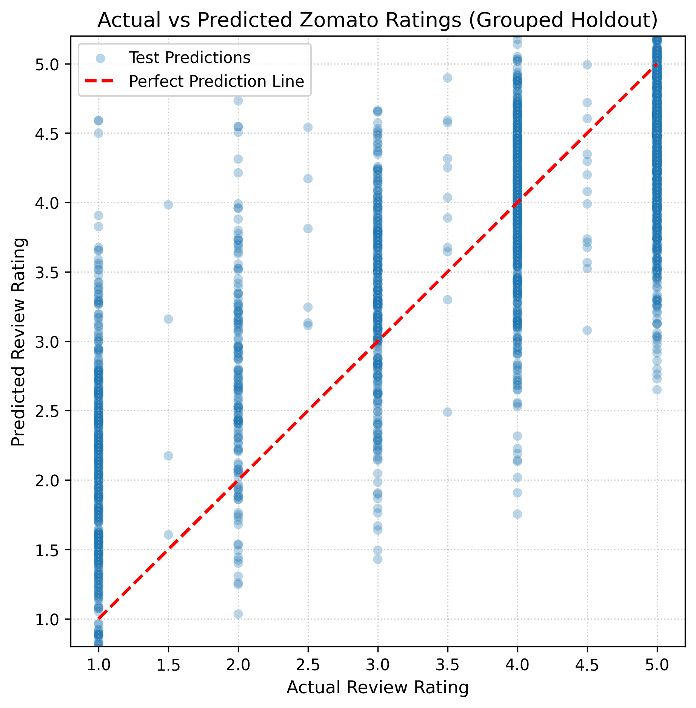

# Zomato Restaurant Reviews - Rating Prediction

An end-to-end Machine Learning project to merge, clean, analyze, and predict customer review ratings for restaurants on Zomato using NLP (TF-IDF) and metadata features.

---

## 📌 Project Overview
This project predicts individual review ratings (`Rating`: 1.0 to 5.0) using customer review text alongside restaurant metadata (cuisines, timing, collections, cost, picture counts, and review timestamps).

The model uses a **restaurant-grouped holdout split (80/20)**, ensuring that evaluation takes place on restaurants unseen during training to test true generalization.

---

## 📊 Dataset Description
1. **`Zomato Restaurant reviews.csv`**: Contains 10,000 raw customer reviews, star ratings, review timestamps, reviewer names, and picture counts.
2. **`Zomato Restaurant names and Metadata.csv`**: Contains restaurant metadata including cuisines, operational timings, collections, and cost estimates.
3. **`zomato_merged_cleaned.csv`**: Cleaned and deduplicated merged dataset (9,954 records) ready for model training and analysis.

---

## 🛠️ Machine Learning Pipeline
1. **Data Preprocessing & Cleaning**:
   - Cleaned string whitespace and dropped invalid/non-numeric ratings.
   - Parsed cost strings (removed commas) and extracted temporal features (`ReviewHour`, `ReviewMonth`, `ReviewDayOfWeek`).
   - Deduplicated restaurant metadata to prevent row inflation during joins.
2. **Feature Engineering**:
   - **Textual Features**: TF-IDF Vectorizer with unigrams & bigrams (`ngram_range=(1, 2)`), sublinear term frequency, English stopword removal, and top 30,000 features.
   - **Categorical Features**: One-hot encoding with unknown category handling for `Restaurant`, `Cuisines`, `Collections`, and `Timings`.
   - **Numerical Features**: Median imputation and standard scaling for `Cost`, `Pictures`, and datetime attributes.
3. **Model & Validation**:
   - **Holdout Validation**: `GroupShuffleSplit` (80% train / 20% test) grouped by `Restaurant` name.
   - **Algorithm**: Regularized Linear Ridge Regressor (`alpha=2.0`, solver: `lsqr`).

---

## 📈 Evaluation Results

| Metric | Model Performance | Baseline (Median Prediction) |
| :--- | :---: | :---: |
| **Mean Absolute Error (MAE)** | **0.7046** | 1.1872 |
| **Root Mean Squared Error (RMSE)** | **0.8998** | 1.4880 |
| **R² Score** | **0.6256** | 0.0000 |
| **Improvement vs Baseline** | **+40.66%** | - |

*(Evaluated on unseen restaurants in the grouped test split)*

### Actual vs Predicted Ratings
The model accurately captures review sentiment and ratings across the 1.0 to 5.0 scale:


---

## 📁 Repository Structure
```
├── Zomato Restaurant reviews.csv            # Raw reviews dataset
├── Zomato Restaurant names and Metadata.csv   # Raw restaurant metadata
├── zomato_merged_cleaned.csv                # Merged & cleaned analysis-ready dataset
├── zomato_rating_model.joblib               # Trained ML pipeline artifact
├── actual_vs_predicted.png                  # Evaluation plot (scatter + parity line)
├── run_project.py                           # Standalone executable Python pipeline script
├── Zomato_Rating_Prediction_Colab.ipynb     # Jupyter / Google Colab interactive notebook
├── Sample_ML_Submission_Template.ipynb      # Submission notebook template
├── Zomato project.pptx                      # Project presentation deck
├── .gitignore                               # Git ignore rules
└── README.md                                # Project documentation
```

---

## 🚀 How to Run the Project

### Option 1: Standalone Python Script (Recommended)
Clone the repository and run:
```bash
python run_project.py
```
This executes the full pipeline end-to-end, evaluates the model, saves the evaluation plot (`actual_vs_predicted.png`), and outputs `zomato_rating_model.joblib`.

### Option 2: Jupyter Notebook / Google Colab
Open `Zomato_Rating_Prediction_Colab.ipynb` locally in Jupyter Notebook / VS Code, or upload it to Google Colab. The notebook auto-detects its environment and runs seamlessly in both.
